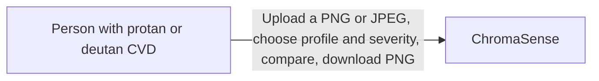
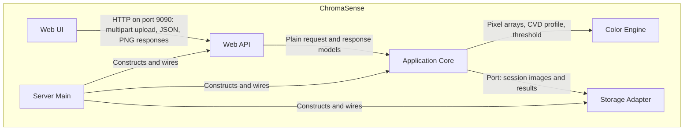

# Architecture

You fill this file in stage 2 (see `README.md`).

Do not list prompt filenames here. Do not repeat requirements. When a decision satisfies a requirement, cite its `SRS-FR-` or `SRS-NFR-` ID.

## Required: Context

The C4 context view: the people and external systems around this software. If a node does not exist, delete it.

ChromaSense calls no external system.

## Required: Containers

The C4 container view: the main runnable or deployable parts, and how they call each other. Use one node for each part in the list below.

Everything except the Web UI runs in one Docker container. Arrows show runtime calls. Storage Adapter is called through a port that Application Core owns, so its source dependency points inward.

## Required: Parts

Name each major part and its job. The agent must not add a part that is not in this list.

- **Web UI**: Server-rendered pages, styles, and plain browser scripts. Holds one workflow: upload, profile and severity, side-by-side or slider comparison, status messages, and download. Tells the server when the page is closed. Does no pixel processing.
- **Web API**: Humble HTTP adapter. Serves the page and REST endpoints, assigns an anonymous session ID in a cookie, caps the request body at the upload limit, checks request shape, maps requests to use case calls, and maps results and errors to responses with a clear reason.
- **Application Core**: Use cases and the policy they need: process upload, enhance image, render view, export image, end session, and purge idle sessions. Runs the pipeline filters in order, applies the input limits and the confusion threshold, and owns the ports for storage and the clock.
- **Color Engine**: Separate, installable Python package of pipeline filters and color rules: decode and validate, palette extraction, confusion detection, enhancement, separation check, CVD simulation, CIEDE2000 distance, and PNG encoding.
- **Storage Adapter**: Implements the storage port. Keeps each session's original and enhanced images on the local filesystem, under one folder per session, and deletes that folder when the session ends.
- **Server Main**: Composition root. Reads configuration, constructs and wires the parts, deletes leftover session folders at startup, starts the server on port 9090, and schedules the idle session purge.

## Optional: Classes and functions

The basic contracts inside each part. The agent may add private helpers and small data classes inside a part, but must keep these names.

### Naming rule

Only Pipe and Filter pipeline code is numbered, and the number is its position in the pipeline. Everything required by Clean Architecture (use cases, ports, adapters, storage, Docker, and wiring) and every shared color rule stays unnumbered. Python names cannot start with a digit or contain a hyphen, so the number follows a word:

- Directory: `filter_<N>_<name>`
- Function: `<name>_<N>`
- Output class: `<Name><N>`

### Pipeline filters (Color Engine)

| N | Directory | Function | Output class | SRS IDs |
| --- | --- | --- | --- | --- |
| 1 | `filter_1_decode` | `decode_1(data: bytes, limits: InputLimits)` | `DecodedImage1` | SRS-FR-001, SRS-FR-002, SRS-NFR-004 |
| 2 | `filter_2_palette` | `extract_palette_2(pixels: NDArray, color_count: int)` | `Palette2` | SRS-FR-005 |
| 3 | `filter_3_confusion` | `detect_confusion_3(pixels: NDArray, palette: Palette2, profile: CvdProfile, threshold: float)` | `ConfusionResult3` | SRS-FR-005 |
| 4 | `filter_4_enhance` | `enhance_4(pixels: NDArray, confusion: ConfusionResult3)` | `EnhancedImage4` | SRS-FR-006, SRS-FR-007 |
| 5 | `filter_5_separation` | `check_separation_5(confusion: ConfusionResult3, enhanced: EnhancedImage4, profile: CvdProfile, threshold: float)` | `SeparationReport5` | SRS-FR-009, SRS-NFR-007 |

- `decode_1` checks the actual file content, accepts only PNG and JPEG, rejects files that are corrupt or over the megapixel limit with a reason code, applies the EXIF orientation, and converts any embedded color profile to sRGB. Its output is 8-bit sRGB pixels.
- `detect_confusion_3` flags a palette pair as confusable when its CIEDE2000 distance is at least the threshold in the original and below it after simulation. Its output holds the pairs, their before distances, and a mask of the pixels that belong to flagged colors.
- `enhance_4` changes only pixels inside the mask.
- `check_separation_5` reports, for each flagged pair, the simulated distance before and after enhancement, and whether it improved. It also reports any pair that is newly confusable after enhancement.

The use cases run the filters in these orders:

- **Upload**: 1 only. The original is stored and shown before any profile is applied (SRS-FR-004).
- **Enhance**: 2, 3, 4, 5 on the stored original. The palette from 2 is stored and reused when only the profile changes (SRS-FR-011).
- **Export**: no filter. It encodes the stored enhanced pixels as PNG (SRS-FR-010).

Each filter can be tested on its own with plain arrays.

### Color rules (Color Engine, unnumbered)

Filters and use cases may call these. They are not pipeline stages.

- `CvdType` (enum: `PROTAN`, `DEUTAN`), `CvdProfile` (`type`, `severity` from 0 to 1), `InputLimits` (`max_bytes`, `max_megapixels`)
- `srgb_to_linear(pixels)`, `linear_to_srgb(pixels)`
- `simulate(pixels, profile)`: Machado (2009) in linear RGB, interpolated by severity
- `ciede2000(lab_a, lab_b)`
- `encode_png(pixels) -> bytes`

### Ports (Application Core)

Each port is a `typing.Protocol`.

- `SessionImageStore`: `save_original(session_id, image)`, `load_original(session_id)`, `save_result(session_id, result)`, `load_result(session_id)`, `delete_session(session_id)`, `idle_sessions(before)`, `touch(session_id, now)`
- `Clock`: `now()`

### Use cases (Application Core)

Each use case is one class with `execute(request) -> response`, using plain dataclasses for both.

- `ProcessUpload`, `EnhanceImage`, `RenderView`, `ExportImage`, `EndSession`, `PurgeIdleSessions`

### Core models and policy (Application Core)

- Models: `SessionImage`, `EnhancementResult`, `PairOutcome`, `Outcome` (enum: `ENHANCED`, `NO_CONFUSABLE_PAIRS`, `NOT_IMPROVED`), `UploadRejection` (enum: `UNSUPPORTED_TYPE`, `CORRUPT`, `TOO_LARGE`, `TOO_MANY_PIXELS`)
- `ProcessingSettings` (`threshold`, `color_count`, `input_limits`)
- `outcome_for(report: SeparationReport5) -> Outcome`

### Adapters and wiring (unnumbered)

- **Storage Adapter**: `FilesystemSessionImageStore`
- **Web API**: `create_app(use_cases, ...)`, routers `pages_router`, `images_router`, and `session_router`, and Pydantic request and response schemas
- **Server Main**: `Settings`, `SystemClock`, `build_app(settings)`, `main()`

### Endpoints

| Method | Endpoint | Use case |
| --- | --- | --- |
| GET | `/` | Page |
| POST | `/api/image` | `ProcessUpload`, which replaces the session's previous image |
| POST | `/api/image/enhance` | `EnhanceImage` with profile and severity |
| GET | `/api/image/view/{original or enhanced}` | `RenderView` |
| GET | `/api/image/export` | `ExportImage` |
| POST | `/api/session/end` | `EndSession`, sent with `navigator.sendBeacon` when the page closes |

## Required: Stack

Language, runtime, frameworks, and build tool.

- **Language and runtime**: Python 3.11 in a Docker container, with Docker Compose and a committed dev container for development
- **Web**: FastAPI on Uvicorn, with python-multipart for uploads, Jinja2 server-rendered pages, and plain JavaScript and CSS, with no JavaScript build step
- **Imaging and color**: NumPy, Pillow (decode, color profile conversion, EXIF orientation, PNG encoding), scikit-image for CIELAB and CIEDE2000, scikit-learn for k-means
- **Storage**: Local filesystem, on a Docker volume
- **Build and packaging**: `pyproject.toml` for each Python package, installed with pip in the Docker image build
- **Quality**: pytest and pytest-cov, DaltonLens as a test-only reference for simulation, Ruff for linting, formatting, and docstrings (pydocstyle `D` rules, Google convention), import-linter for dependency rules, Playwright with axe-playwright-python for browser and accessibility tests, and GitHub Actions for pull request checks
- **Test host**: the Docker container limited to 4 CPU cores and 8 GB of memory, used for SRS-NFR-001 timing runs

## Required: Hard constraints

Rules that the agent must not break. Examples: a required library, a required format, work that is forbidden even if an SRS row could permit it.

- Source dependencies point inward: Web API, Storage Adapter, and Server Main may import Application Core; Application Core may import Color Engine; neither may import an outer part. CI enforces this with import-linter.
- Color Engine imports only NumPy, Pillow, scikit-image, scikit-learn, and the standard library. It makes no network calls and reads no environment variables. Its tests run without FastAPI installed.
- Application Core imports no FastAPI or filesystem code, and its tests run with fakes for every port.
- Web API and Storage Adapter hold no business rules. Limits, the threshold, and outcome messages belong in Application Core or Color Engine.
- Only Color Engine processes pixels, on the server. The Web UI must not compute colors or simulations in the browser.
- No component calls an external service. Add no AI provider, HTTP client, text recognition, speech, or color naming code. (SRS out of scope)
- Support only protan and deutan. Do not add tritan, achromatopsia, or a no CVD option.
- Accept only PNG and JPEG, at most 10 MB and 12 megapixels. Reject larger images; do not downscale them. (SRS-FR-002, SRS-NFR-004)
- Export only PNG. Pixels outside the mask in the exported PNG must equal the decoded sRGB original exactly. (SRS-FR-007, SRS-FR-010)
- Keep at most one image and its result for each session. Write nothing from an upload outside that session's folder, and do not log image content. (SRS-NFR-005)
- Interface text must not claim to diagnose CVD, give medical advice, or show exactly what typical color vision sees. (SRS-NFR-006)
- Every status message has text, and no control or state is shown by color alone. (SRS-NFR-003)
- Add no account system, database, message queue, separate worker service, or second web framework.
- Each filter takes plain data and returns plain data, and no filter calls another filter. Only the Application Core use case decides the order.
- Every public module, class, and function in `src/` has a Google-style docstring. Public Color Engine functions and each use case `execute` also document `Args`, `Returns`, and `Raises`. Each document in the documentation set states its audience and purpose. (SRS-NFR-008)

## Required: Decisions

Record one to three decisions that you already made. Delete the unused decision blocks. The agent must follow these decisions and must not invent a competing architecture.

### Decision 1

- **Context**: The color rules must stay testable on their own and reusable for the acceptance evaluation, while the web layer may change. Each enhancement runs a fixed sequence of image stages.
- **Decision**: Use Clean Architecture for the overall structure and Pipe and Filter for the pipeline, as in release 0.5, reduced to the parts above. Render pages on the server with semantic HTML and add plain JavaScript only for upload, the severity slider, the comparison slider, live status messages, and the page-close beacon.
- **Rejected**: Pipeline logic in request handlers, because it ties the color rules to the framework and the evaluation could not run them directly. A single-page application framework, because it adds a build step and makes focus and announcement behavior harder to keep correct.
- **SRS IDs**: SRS-FR-004, SRS-FR-008, SRS-FR-011, SRS-NFR-002, SRS-NFR-003

### Decision 2

- **Context**: The SRS states the outcome of detection and enhancement but not the method, and the 80 percent target needs a fixed way to measure simulated separation. The release 0.5 evaluation (`docs/enhancement-evaluation-v0.5.md`) compared three enhancement methods.
- **Decision**: Simulate protan and deutan with the Machado (2009) model in linear RGB, interpolated by severity. Extract the palette with k-means in CIELAB. Measure separation as the CIEDE2000 distance between simulated colors. A pair is eligible when it is confusable under the default threshold of 10, and it is improved when its simulated distance after enhancement is greater than before. Enhance with lightness separation, which reduced confusable pairs by 94.8 percent in the release 0.5 evaluation and moves only lightness inside the mask. The threshold, color count, and severity used in each evaluation run are recorded with the results.
- **Rejected**: Targeted daltonization and hue rotation, which removed fewer pairs in the release 0.5 evaluation. A global filter, because it would change pixels outside the targeted regions.
- **SRS IDs**: SRS-FR-005, SRS-FR-006, SRS-FR-007, SRS-FR-009, SRS-NFR-001, SRS-NFR-007

### Decision 3

- **Context**: Uploaded pictures must not outlive the active session, but there are no accounts, and a closed tab does not always reach the server.
- **Decision**: A session is the anonymous ID in a cookie. It ends at the first of these: the page sends the end-session beacon when it closes, the session is idle for a configurable time (default 30 minutes), or the server restarts. Ending a session deletes its folder. Server Main runs the idle purge every minute and clears all session folders at startup. A new upload replaces the session's previous image and result.
- **Rejected**: A fixed retention period, such as 24 hours, which keeps pictures after the user leaves. Keeping images only in memory, which would make export of a 12 megapixel result depend on one worker process.
- **SRS IDs**: SRS-FR-011, SRS-NFR-005

## Required: Primary design rule

During implementation, the agent may read one book rule file. That file biases how the agent writes code inside the boundaries above. It is not a second architecture.

none
