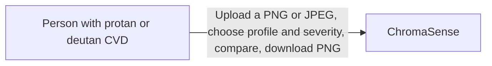
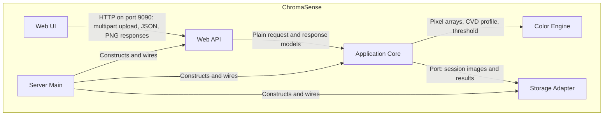

# Prompt 0: Master context

Reload this file at the start of every implementation session. It is not an implementation step. It repeats the user files so that each session starts from the same facts. If this file and `dev/srs.md`, `dev/architecture.md`, or `dev/structure.md` disagree, the user file wins: stop and report the difference.

### Main rules

- Build only **ChromaSense: Color Vision Image Enhancement Web App**, as `dev/srs.md` describes it.
- Add no requirement, part, screen, folder, endpoint, or behavior that the user files do not name.
- Follow the parts, hard constraints, and decisions in `dev/architecture.md` and the tree in `dev/structure.md`.
- Run one increment at a time, in file order, and update `dev/prompts/tracking.md` after each one.
- `Archive/` is read only. You may read archived code to port it, but the new code must follow the new contracts, and nothing may import or copy from `Archive/` at build or run time.

## 1. Domain background

**Purpose.** This specification is for Team BlindSpot, the course instructor, testers, and the agents that generate and implement the build. The build must satisfy the requirements below, and every `must` verification must hold.

**Scope.** ChromaSense is a web app that helps people with red–green color vision deficiency (CVD) tell apart details in their own pictures. The user uploads a still PNG or JPEG image, selects a protan or deutan profile and a severity, compares the enhanced image with the original, and downloads the result. The system finds colors that become hard to distinguish under the selected profile and adjusts only those colors in the targeted regions. Everyday photos, charts, maps, and other graphics use the same controls and pipeline, and results can vary with image content. The goal is to help the user identify the same visual details that a viewer with typical color vision sees.

**Product perspective.** ChromaSense is a new, self-contained product. It runs on a development server on the local network and processes images on the server. Users reach it with a web browser on the same local network. It calls no external systems, and image processing does not need internet access.

**Users.**

- People with protan or deutan CVD (can use a web browser, and know or choose their profile) — upload a picture, enhance the confusable colors, compare the result with the original, and download it

**Product functions.**

- Upload a PNG or JPEG image with the browser file picker
- Reject invalid files with a clear reason
- Select a protan or deutan profile and a severity
- Detect colors that become confusable under the selected profile
- Enhance only the confusable colors in targeted regions
- Compare the original and enhanced images
- Download the enhanced image as a PNG
- Replace the image or change the profile and generate a new result

**Assumptions and dependencies.**

- Users have a current version of Chrome, Edge, Firefox, or Safari on a desktop or mobile device
- The browser and the server are on the same local network
- Published CVD simulation models are accurate enough to measure simulated perceptual separation
- Display color accuracy depends on the user's device settings

**Out of scope. Do not build any of these.**

- AI image description and chart interpretation
- Voice input or output
- Severe low vision support
- Live camera and video
- Calibration or diagnosis of CVD
- Color naming tools
- User accounts and profile sync
- Browser extensions and native mobile apps
- Access from outside the local network
- Tritan and achromatopsia profiles (possible future extensions)
- Presenting output as medical advice, a CVD diagnosis, or an exact reconstruction of typical color perception

**Input limits and data.**

**User interface:** one workflow: upload, choose the profile and severity, compare the original and enhanced images, and download.

**Input limits:** still PNG or JPEG, up to 10 MB and 12 megapixels.

**Communication:** the browser reaches the development server over the local network.

- Profile: protan or deutan, and severity from 0 to 1
- Session image: the uploaded original and the enhanced result, kept only for the active session

**Color background.** Protan and deutan CVD reduce the difference between some reds and greens. The app simulates the selected profile with the Machado (2009) model in linear RGB, measures color differences with CIEDE2000 in CIELAB, and flags a palette pair as confusable when it is at least the threshold apart in the original and below the threshold after simulation. It then moves the CIELAB lightness of the flagged colors apart, inside a mask of their pixels only, and checks that the simulated distance grew.

## 2. System architecture overview

### Context

ChromaSense calls no external system.



### Containers

Everything except the Web UI runs in one Docker container. Arrows show runtime calls. Storage Adapter is called through a port that Application Core owns, so its source dependency points inward.



### Parts

- **Web UI**: Server-rendered pages, styles, and plain browser scripts. Holds one workflow: upload, profile and severity, side-by-side or slider comparison, status messages, and download. Tells the server when the page is closed. Does no pixel processing.
- **Web API**: Humble HTTP adapter. Serves the page and REST endpoints, assigns an anonymous session ID in a cookie, caps the request body at the upload limit, checks request shape, maps requests to use case calls, and maps results and errors to responses with a clear reason.
- **Application Core**: Use cases and the policy they need: process upload, enhance image, render view, export image, end session, and purge idle sessions. Runs the pipeline filters in order, applies the input limits and the confusion threshold, and owns the ports for storage and the clock.
- **Color Engine**: Separate, installable Python package of pipeline filters and color rules: decode and validate, palette extraction, confusion detection, enhancement, separation check, CVD simulation, CIEDE2000 distance, and PNG encoding.
- **Storage Adapter**: Implements the storage port. Keeps each session's original and enhanced images on the local filesystem, under one folder per session, and deletes that folder when the session ends.
- **Server Main**: Composition root. Reads configuration, constructs and wires the parts, deletes leftover session folders at startup, starts the server on port 9090, and schedules the idle session purge.

### Decisions

### Decision 1

- **Context**: The color rules must stay testable on their own and reusable for the acceptance evaluation, while the web layer may change. Each enhancement runs a fixed sequence of image stages.
- **Decision**: Use Clean Architecture for the overall structure and Pipe and Filter for the pipeline, as in the archived build, reduced to the parts above. Render pages on the server with semantic HTML and add plain JavaScript only for upload, the severity slider, the comparison slider, live status messages, and the page-close beacon.
- **Rejected**: Pipeline logic in request handlers, because it ties the color rules to the framework and the evaluation could not run them directly. A single-page application framework, because it adds a build step and makes focus and announcement behavior harder to keep correct.
- **SRS IDs**: SRS-FR-004, SRS-FR-008, SRS-FR-011, SRS-NFR-002, SRS-NFR-003

### Decision 2

- **Context**: The SRS states the outcome of detection and enhancement but not the method, and the 80 percent target needs a fixed way to measure simulated separation. The archived evaluation (`Archive/BlindSpot_ChromaSense-main/docs/enhancement-evaluation.md`) compared three enhancement methods.
- **Decision**: Simulate protan and deutan with the Machado (2009) model in linear RGB, interpolated by severity. Extract the palette with k-means in CIELAB. Measure separation as the CIEDE2000 distance between simulated colors. A pair is eligible when it is confusable under the default threshold of 10, and it is improved when its simulated distance after enhancement is greater than before. Enhance with lightness separation, which reduced confusable pairs by 94.8 percent in the archived evaluation and moves only lightness inside the mask. The threshold, color count, and severity used in each evaluation run are recorded with the results.
- **Rejected**: Targeted daltonization and hue rotation, which removed fewer pairs in the archived evaluation. A global filter, because it would change pixels outside the targeted regions.
- **SRS IDs**: SRS-FR-005, SRS-FR-006, SRS-FR-007, SRS-FR-009, SRS-NFR-001, SRS-NFR-007

### Decision 3

- **Context**: Uploaded pictures must not outlive the active session, but there are no accounts, and a closed tab does not always reach the server.
- **Decision**: A session is the anonymous ID in a cookie. It ends at the first of these: the page sends the end-session beacon when it closes, the session is idle for a configurable time (default 30 minutes), or the server restarts. Ending a session deletes its folder. Server Main runs the idle purge every minute and clears all session folders at startup. A new upload replaces the session's previous image and result.
- **Rejected**: A fixed retention period, such as 24 hours, which keeps pictures after the user leaves. Keeping images only in memory, which would make export of a 12 megapixel result depend on one worker process.
- **SRS IDs**: SRS-FR-011, SRS-NFR-005

## 3. Component specifications

### Naming rule

Only Pipe and Filter pipeline code is numbered, and the number is its position in the pipeline. Everything required by Clean Architecture (use cases, ports, adapters, storage, Docker, and wiring) and every shared color rule stays unnumbered. Python names cannot start with a digit or contain a hyphen, so the number follows a word:

- Directory: `filter_<N>_<name>`
- Function: `<name>_<N>`
- Output class: `<Name><N>`

### Pipeline filters (Color Engine)

| N | Directory | Function | Output class | SRS IDs |
| --- | --- | --- | --- | --- |
| 1 | `filter_1_decode` | `decode_1(data: bytes, limits: InputLimits)` | `DecodedImage1` | SRS-FR-001, SRS-FR-002, SRS-NFR-004 |
| 2 | `filter_2_palette` | `extract_palette_2(pixels: NDArray, color_count: int)` | `Palette2` | SRS-FR-005 |
| 3 | `filter_3_confusion` | `detect_confusion_3(pixels: NDArray, palette: Palette2, profile: CvdProfile, threshold: float)` | `ConfusionResult3` | SRS-FR-005 |
| 4 | `filter_4_enhance` | `enhance_4(pixels: NDArray, confusion: ConfusionResult3)` | `EnhancedImage4` | SRS-FR-006, SRS-FR-007 |
| 5 | `filter_5_separation` | `check_separation_5(confusion: ConfusionResult3, enhanced: EnhancedImage4, profile: CvdProfile, threshold: float)` | `SeparationReport5` | SRS-FR-009, SRS-NFR-007 |

- `decode_1` checks the actual file content, accepts only PNG and JPEG, rejects files that are corrupt or over the megapixel limit with a reason code, applies the EXIF orientation, and converts any embedded color profile to sRGB. Its output is 8-bit sRGB pixels.
- `detect_confusion_3` flags a palette pair as confusable when its CIEDE2000 distance is at least the threshold in the original and below it after simulation. Its output holds the pairs, their before distances, and a mask of the pixels that belong to flagged colors.
- `enhance_4` changes only pixels inside the mask.
- `check_separation_5` reports, for each flagged pair, the simulated distance before and after enhancement, and whether it improved. It also reports any pair that is newly confusable after enhancement.

The use cases run the filters in these orders:

- **Upload**: 1 only. The original is stored and shown before any profile is applied (SRS-FR-004).
- **Enhance**: 2, 3, 4, 5 on the stored original. The palette from 2 is stored and reused when only the profile changes (SRS-FR-011).
- **Export**: no filter. It encodes the stored enhanced pixels as PNG (SRS-FR-010).

Each filter can be tested on its own with plain arrays.

### Color rules (Color Engine, unnumbered)

Filters and use cases may call these. They are not pipeline stages.

- `CvdType` (enum: `PROTAN`, `DEUTAN`), `CvdProfile` (`type`, `severity` from 0 to 1), `InputLimits` (`max_bytes`, `max_megapixels`)
- `srgb_to_linear(pixels)`, `linear_to_srgb(pixels)`
- `simulate(pixels, profile)`: Machado (2009) in linear RGB, interpolated by severity
- `ciede2000(lab_a, lab_b)`
- `encode_png(pixels) -> bytes`

### Ports (Application Core)

Each port is a `typing.Protocol`.

- `SessionImageStore`: `save_original(session_id, image)`, `load_original(session_id)`, `save_result(session_id, result)`, `load_result(session_id)`, `delete_session(session_id)`, `idle_sessions(before)`, `touch(session_id, now)`
- `Clock`: `now()`

### Use cases (Application Core)

Each use case is one class with `execute(request) -> response`, using plain dataclasses for both.

- `ProcessUpload`, `EnhanceImage`, `RenderView`, `ExportImage`, `EndSession`, `PurgeIdleSessions`

### Core models and policy (Application Core)

- Models: `SessionImage`, `EnhancementResult`, `PairOutcome`, `Outcome` (enum: `ENHANCED`, `NO_CONFUSABLE_PAIRS`, `NOT_IMPROVED`), `UploadRejection` (enum: `UNSUPPORTED_TYPE`, `CORRUPT`, `TOO_LARGE`, `TOO_MANY_PIXELS`)
- `ProcessingSettings` (`threshold`, `color_count`, `input_limits`)
- `outcome_for(report: SeparationReport5) -> Outcome`

### Adapters and wiring (unnumbered)

- **Storage Adapter**: `FilesystemSessionImageStore`
- **Web API**: `create_app(use_cases, ...)`, routers `pages_router`, `images_router`, and `session_router`, and Pydantic request and response schemas
- **Server Main**: `Settings`, `SystemClock`, `build_app(settings)`, `main()`

### Endpoints

| Method | Endpoint | Use case |
| --- | --- | --- |
| GET | `/` | Page |
| POST | `/api/image` | `ProcessUpload`, which replaces the session's previous image |
| POST | `/api/image/enhance` | `EnhanceImage` with profile and severity |
| GET | `/api/image/view/{original or enhanced}` | `RenderView` |
| GET | `/api/image/export` | `ExportImage` |
| POST | `/api/session/end` | `EndSession`, sent with `navigator.sendBeacon` when the page closes |

## 4. Requirements and success metrics

Every row below must be satisfied. A `must` row's verification must hold before the project is complete.

| ID | Statement | Priority | Verification |
| --- | --- | --- | --- |
| SRS-FR-001 | The user shall select a PNG or JPEG image with the browser file picker. (FR-01) | must | Valid PNG and JPEG photos, charts, and maps appear in the same workspace. |
| SRS-FR-002 | The app shall reject unsupported, corrupt, oversized, or over-resolution files with a clear reason. (FR-02) | must | Invalid sample files display an error and are not processed. |
| SRS-FR-003 | The user shall select a protan or deutan profile and a severity value between 0 and 1. (FR-03) | must | Both profiles and the slider limits are available and affect processing. |
| SRS-FR-004 | The app shall show the original image before processing and retain it for comparison. (FR-04) | must | The original remains available throughout the session. |
| SRS-FR-005 | The system shall identify colors that become difficult to distinguish under the selected profile. (FR-05) | must | Known red–green test pairs are flagged, and distinct pairs are not. |
| SRS-FR-006 | The system shall produce an enhanced image by adjusting the flagged colors to increase their distinguishability under the selected profile. (FR-06) | must | Simulated separation increases for eligible test pairs. |
| SRS-FR-007 | The system shall leave pixels outside the targeted color regions unchanged, apart from unavoidable file encoding differences. (FR-07) | must | A pixel comparison shows that changes are limited to targeted regions. |
| SRS-FR-008 | The app shall display the original and enhanced images side by side or through a comparison slider. (FR-08) | must | The user can inspect the same image area in both versions. |
| SRS-FR-009 | The app shall state when no confusable color pair was found or when enhancement could not improve a pair. (FR-09) | must | Each case displays a clear message rather than an unexplained result. |
| SRS-FR-010 | The user shall download the enhanced image as a PNG. (FR-10) | must | The downloaded file opens and matches the displayed result. |
| SRS-FR-011 | The user shall replace the image or change the profile and generate a new result. (FR-11) | must | A new image or profile produces an updated result. |
| SRS-NFR-001 | For a valid image within the stated limits, processing shall finish or report a recoverable error within 30 seconds on the documented test host. (NFR-01) | must | Timed runs on the test host meet the limit. |
| SRS-NFR-002 | The browser interface shall support keyboard operation, visible focus, screen reader labels, and layouts usable on desktop and mobile screens. (NFR-02) | must | Keyboard and accessibility walkthroughs complete the main workflow. |
| SRS-NFR-003 | Controls and status messages shall not rely on color alone and shall meet WCAG 2.2 AA text contrast requirements. (NFR-03) | must | Accessibility checks and manual review pass. |
| SRS-NFR-004 | The server shall validate actual file content and limit upload size before image processing. (NFR-04) | must | Renamed non-image files and oversized files are rejected. |
| SRS-NFR-005 | The app shall not require a user account or retain uploaded pictures after the active session ends. (NFR-05) | must | Session cleanup removes the original and processed files. |
| SRS-NFR-006 | The app shall not represent its output as medical advice, a color vision diagnosis, or an exact reconstruction of typical color perception. (NFR-06) | must | Interface copy and help text avoid those claims. |
| SRS-NFR-007 | Enhancement shall improve simulated perceptual separation for at least 80 percent of eligible color pairs for each profile on the held-out test set. (Section 1.1) | must | The acceptance evaluation reports the improved and eligible pair counts for each profile, and the ratio is at least 80 percent. |

**Acceptance plan.**

From Section 6 of the source document.

1. Before tuning, set aside labeled PNG and JPEG photos, charts, and maps. Identify target regions and reference colors in each image.
2. For each profile, count the pairs that fall below the chosen simulated color-distance threshold in the original.
3. Measure those regions after enhancement with the same profile and severity.
4. Report the improved and eligible counts by profile and image type, with newly confusable pairs and any changes outside the target regions. Record the threshold and severity.
5. Automated checks also cover upload validation, profile selection, and PNG export.
6. For the demo, prepare one question with a known answer for each image. If people with red–green CVD are available, record answer accuracy, completion time, and feedback on original and enhanced images.

**Success metrics for the build.**

- Every row in `dev/prompts/tracking.md` is `green`.
- `docker compose build` succeeds.
- Every extra check in section 6 passes.
- Every `must` verification above holds, and the tree matches section 6.

## 5. Technical constraints and stack

### Stack

- **Language and runtime**: Python 3.11 in a Docker container, with Docker Compose and a committed dev container for development
- **Web**: FastAPI on Uvicorn, with python-multipart for uploads, Jinja2 server-rendered pages, and plain JavaScript and CSS, with no JavaScript build step
- **Imaging and color**: NumPy, Pillow (decode, color profile conversion, EXIF orientation, PNG encoding), scikit-image for CIELAB and CIEDE2000, scikit-learn for k-means
- **Storage**: Local filesystem, on a Docker volume
- **Build and packaging**: `pyproject.toml` for each Python package, installed with pip in the Docker image build
- **Quality**: pytest and pytest-cov, DaltonLens as a test-only reference for simulation, Ruff for linting and formatting, import-linter for dependency rules, Playwright with axe-playwright-python for browser and accessibility tests, and GitHub Actions for pull request checks
- **Test host**: the Docker container limited to 4 CPU cores and 8 GB of memory, used for SRS-NFR-001 timing runs

### Hard constraints

- Source dependencies point inward: Web API, Storage Adapter, and Server Main may import Application Core; Application Core may import Color Engine; neither may import an outer part. CI enforces this with import-linter.
- Color Engine imports only NumPy, Pillow, scikit-image, scikit-learn, and the standard library. It makes no network calls and reads no environment variables. Its tests run without FastAPI installed.
- Application Core imports no FastAPI or filesystem code, and its tests run with fakes for every port.
- Web API and Storage Adapter hold no business rules. Limits, the threshold, and outcome messages belong in Application Core or Color Engine.
- Only Color Engine processes pixels, on the server. The Web UI must not compute colors or simulations in the browser.
- No component calls an external service. Add no AI provider, HTTP client, text recognition, speech, or color naming code. (SRS out of scope)
- Support only protan and deutan. Do not add tritan, achromatopsia, or a no CVD option.
- Accept only PNG and JPEG, at most 10 MB and 12 megapixels. Reject larger images; do not downscale them. (SRS-FR-002, SRS-NFR-004)
- Export only PNG. Pixels outside the mask in the exported PNG must equal the decoded sRGB original exactly. (SRS-FR-007, SRS-FR-010)
- Keep at most one image and its result for each session. Write nothing from an upload outside that session's folder, and do not log image content. (SRS-NFR-005)
- Interface text must not claim to diagnose CVD, give medical advice, or show exactly what typical color vision sees. (SRS-NFR-006)
- Every status message has text, and no control or state is shown by color alone. (SRS-NFR-003)
- Add no account system, database, message queue, separate worker service, or second web framework.
- Each filter takes plain data and returns plain data, and no filter calls another filter. Only the Application Core use case decides the order.

### Design constraints from the SRS

- Images are processed on the server.
- The app runs on a development server reachable over the local network.
- All pages must meet WCAG 2.2 AA text contrast.

## 6. Dependencies and directory tree

```
ChromaSense-Color-Vision-Image-Enhancement/
├── .devcontainer/
│   └── devcontainer.json
├── .github/
│   └── workflows/
│       └── ci.yml
├── .dockerignore
├── .env.example
├── .gitignore
├── Dockerfile
├── README.md
├── TEAM_ROLES.md
├── docker-compose.yml
├── Archive/                      (existing, read only)
├── dev/                          (existing)
├── docs/
│   ├── ChromaSense_SRS.docx
│   ├── acceptance-results.md
│   ├── code/
│   │   ├── color-engine.md
│   │   └── portal.md
│   ├── diagrams/
│   │   ├── README.md
│   │   ├── context.mmd
│   │   ├── context.svg
│   │   ├── containers.mmd
│   │   ├── containers.svg
│   │   ├── pipeline.mmd
│   │   └── pipeline.svg
│   └── user-guides/
│       └── user-guide.md
└── src/
    ├── color_engine/
    │   ├── pyproject.toml
    │   ├── color_engine/
    │   │   ├── __init__.py
    │   │   ├── models.py
    │   │   ├── data/
    │   │   │   └── machado_2009.json
    │   │   ├── rules/
    │   │   │   ├── __init__.py
    │   │   │   ├── color_spaces.py
    │   │   │   ├── distance.py
    │   │   │   ├── encode.py
    │   │   │   └── simulation.py
    │   │   └── pipeline/
    │   │       ├── __init__.py
    │   │       ├── filter_1_decode/
    │   │       │   ├── __init__.py
    │   │       │   └── decode_1.py
    │   │       ├── filter_2_palette/
    │   │       │   ├── __init__.py
    │   │       │   └── extract_palette_2.py
    │   │       ├── filter_3_confusion/
    │   │       │   ├── __init__.py
    │   │       │   └── detect_confusion_3.py
    │   │       ├── filter_4_enhance/
    │   │       │   ├── __init__.py
    │   │       │   └── enhance_4.py
    │   │       └── filter_5_separation/
    │   │           ├── __init__.py
    │   │           └── check_separation_5.py
    │   └── tests/
    │       ├── data/
    │       │   ├── samples/
    │       │   └── acceptance/
    │       │       └── labels.json
    │       ├── rules/
    │       │   ├── test_color_spaces.py
    │       │   ├── test_distance.py
    │       │   ├── test_encode.py
    │       │   └── test_simulation.py
    │       ├── pipeline/
    │       │   ├── test_filter_1_decode.py
    │       │   ├── test_filter_2_palette.py
    │       │   ├── test_filter_3_confusion.py
    │       │   ├── test_filter_4_enhance.py
    │       │   └── test_filter_5_separation.py
    │       └── acceptance/
    │           └── test_separation_target.py
    └── portal/
        ├── pyproject.toml
        ├── chromasense/
        │   ├── __init__.py
        │   ├── core/
        │   │   ├── __init__.py
        │   │   ├── errors.py
        │   │   ├── models.py
        │   │   ├── ports.py
        │   │   ├── policy/
        │   │   │   ├── __init__.py
        │   │   │   └── outcome.py
        │   │   └── use_cases/
        │   │       ├── __init__.py
        │   │       ├── end_session.py
        │   │       ├── enhance_image.py
        │   │       ├── export_image.py
        │   │       ├── process_upload.py
        │   │       ├── purge_idle_sessions.py
        │   │       └── render_view.py
        │   ├── storage/
        │   │   ├── __init__.py
        │   │   └── filesystem_session_image_store.py
        │   ├── web_api/
        │   │   ├── __init__.py
        │   │   ├── app.py
        │   │   ├── schemas.py
        │   │   ├── session_cookie.py
        │   │   └── routers/
        │   │       ├── __init__.py
        │   │       ├── images.py
        │   │       ├── pages.py
        │   │       └── session.py
        │   ├── web_ui/
        │   │   ├── templates/
        │   │   │   ├── base.html
        │   │   │   └── index.html
        │   │   └── static/
        │   │       ├── css/
        │   │       │   └── app.css
        │   │       └── js/
        │   │           ├── compare.js
        │   │           ├── profile.js
        │   │           ├── session.js
        │   │           ├── status.js
        │   │           └── upload.js
        │   └── main/
        │       ├── __init__.py
        │       ├── __main__.py
        │       ├── settings.py
        │       └── wiring.py
        └── tests/
            ├── core/
            ├── storage/
            ├── web_api/
            ├── browser/
            └── performance/
                └── test_processing_time.py
```

### Ownership

| Path | Architecture part | What it holds |
| --- | --- | --- |
| `.devcontainer/` | Server Main | Team dev container, using the `dev` target |
| `.github/workflows/ci.yml` | Server Main | Pull request checks: lint, format, dependency rules, engine tests without FastAPI, and portal tests |
| `.dockerignore` | Server Main | Keeps `Archive/`, `dev/`, `docs/`, and `.git/` out of the build context |
| `.env.example` | Server Main | Configuration names with defaults and no secrets: data folder, confusion threshold (10), palette color count, and idle session minutes (30) |
| `.gitignore` | Server Main | Ignores `.env`, caches, coverage output, and local session data |
| `Dockerfile` | Server Main | Multi-stage build with `engine-test`, `dev`, and `runtime` targets on Python 3.11 |
| `docker-compose.yml` | Server Main | `portal` service on port 9090 with 4 CPUs and 8 GB, `dev` service for checks, `diagrams` service that renders `docs/diagrams/*.mmd` to SVG, and the session data volume |
| `README.md` | Server Main | What the app does, how to start it, and how to reach it from another device on the local network |
| `docs/ChromaSense_SRS.docx` | Server Main | The source SRS. Do not edit |
| `docs/acceptance-results.md` | Color Engine | Improved and eligible pair counts by profile and image type, newly confusable pairs, changes outside target regions, and the threshold and severity used |
| `docs/code/` | Color Engine, Application Core | Developer notes for each Python package: public functions, filter order, and how to run its tests |
| `docs/diagrams/*.mmd` | Server Main | Mermaid sources for the context, container, and pipeline diagrams, kept in step with `dev/architecture.md` |
| `docs/diagrams/*.svg` | Server Main | SVG renders of each `.mmd` file, generated by the `diagrams` service. Do not edit them by hand |
| `docs/diagrams/README.md` | Server Main | Lists each diagram with its SVG embedded and a text description of what it shows, and the command that regenerates the SVGs |
| `docs/user-guides/user-guide.md` | Web UI | Step-by-step guide to upload, profile, compare, and download, with the limits and the no-diagnosis statement |
| `src/color_engine/pyproject.toml` | Color Engine | Package definition with no web framework dependency, package data, and coverage settings |
| `src/color_engine/color_engine/models.py` | Color Engine | `CvdType`, `CvdProfile`, `InputLimits`, `DecodeError` with its reason, and the numbered filter output classes |
| `src/color_engine/color_engine/data/machado_2009.json` | Color Engine | Machado (2009) protan and deutan matrices at severity steps of 0.1 |
| `src/color_engine/color_engine/rules/` | Color Engine | Unnumbered color rules: color spaces, CIEDE2000, simulation, and PNG encoding |
| `src/color_engine/color_engine/pipeline/` | Color Engine | The five numbered filters, one directory each |
| `src/color_engine/tests/data/samples/` | Color Engine | Small fixtures: valid PNG and JPEG, a truncated JPEG, a text file renamed as PNG, an over-12-megapixel PNG header, a Display P3 JPEG, an EXIF-rotated JPEG, and red–green flat graphics |
| `src/color_engine/tests/data/acceptance/` | Color Engine | Held-out PNG and JPEG photos, charts, and maps, set aside before tuning, with target regions and reference colors in `labels.json` |
| `src/color_engine/tests/acceptance/test_separation_target.py` | Color Engine | Runs filters 2 to 5 on the held-out set and fails if fewer than 80 percent of eligible pairs improve for either profile |
| `src/color_engine/tests/` | Color Engine | All other engine tests, which run without the portal or FastAPI |
| `src/portal/pyproject.toml` | Server Main | Portal dependencies, the import-linter contracts, and Ruff settings |
| `src/portal/chromasense/core/ports.py` | Application Core | `SessionImageStore` and `Clock` protocols |
| `src/portal/chromasense/core/models.py` | Application Core | `SessionImage`, `EnhancementResult`, `PairOutcome`, `Outcome`, `UploadRejection`, and `ProcessingSettings` |
| `src/portal/chromasense/core/errors.py` | Application Core | `UploadRejected` and `NoImageInSession`, each carrying a user-facing reason |
| `src/portal/chromasense/core/policy/outcome.py` | Application Core | `outcome_for`, which turns a separation report into an outcome and its message |
| `src/portal/chromasense/core/use_cases/` | Application Core | One file for each use case; `enhance_image.py` sets the filter order |
| `src/portal/chromasense/storage/` | Storage Adapter | `FilesystemSessionImageStore`, with one folder for each session |
| `src/portal/chromasense/web_api/` | Web API | App factory, routers, Pydantic schemas, and the session cookie |
| `src/portal/chromasense/web_ui/` | Web UI | Jinja2 templates, CSS, and browser scripts |
| `src/portal/chromasense/main/` | Server Main | Settings, wiring, startup cleanup, the idle purge task, and the entry point |
| `src/portal/tests/core/` | Application Core | Use case and policy tests with fakes for every port |
| `src/portal/tests/storage/` | Storage Adapter | Store tests on a temporary folder, including session deletion and idle purge |
| `src/portal/tests/web_api/` | Web API | Endpoint tests with fake use cases, including the upload size cap and error reasons |
| `src/portal/tests/browser/` | Web UI | Playwright and axe tests: the full workflow by keyboard, desktop and phone viewports, contrast, and text status messages |
| `src/portal/tests/performance/` | Application Core | Timing of upload plus enhancement on a 12 megapixel image in the reference container |

### Libraries and functions

### Color Engine

| Library | Use these | In | SRS IDs |
| --- | --- | --- | --- |
| `Pillow` | `PIL.Image.open(io.BytesIO(data), formats=["PNG", "JPEG"])`, then check `width * height` against the megapixel limit before `Image.load()` | `filter_1_decode` | SRS-FR-001, SRS-FR-002, SRS-NFR-004 |
| `Pillow` | `PIL.ImageOps.exif_transpose`, `PIL.ImageCms.profileToProfile`, `PIL.ImageCms.createProfile("sRGB")` | `filter_1_decode` | SRS-FR-007 |
| `scikit-learn` | `sklearn.cluster.KMeans` with a fixed `random_state`, on a pixel sample | `filter_2_palette` | SRS-FR-005, SRS-NFR-001 |
| `scikit-image` | `skimage.color.rgb2lab`, `skimage.color.lab2rgb` | `filter_2_palette`, `filter_4_enhance`, `rules/color_spaces.py` | SRS-FR-005, SRS-FR-006 |
| `scikit-image` | `skimage.color.deltaE_ciede2000` | `rules/distance.py` | SRS-FR-005, SRS-NFR-007 |
| `numpy` | Array math, boolean masks, and matrix multiplication | Filters and `rules/` | SRS-FR-006, SRS-FR-007 |
| `Pillow` | `Image.fromarray(...).save(buffer, format="PNG")` | `rules/encode.py` | SRS-FR-010 |
| Standard library | `importlib.resources`, `json` | `rules/simulation.py` | SRS-FR-005 |

### Portal

| Library | Use these | In | SRS IDs |
| --- | --- | --- | --- |
| Standard library | `dataclasses.dataclass`, `typing.Protocol`, `enum.Enum` | `core/` | SRS-FR-009 |
| Standard library | `pathlib.Path`, `shutil.rmtree`, `os.utime` for last-used time | `storage/filesystem_session_image_store.py` | SRS-NFR-005 |
| `fastapi` | `FastAPI` with `lifespan`, `APIRouter`, `UploadFile`, `Depends`, `Response.set_cookie` | `web_api/`, `main/wiring.py` | SRS-FR-001, SRS-FR-011 |
| `fastapi` | `UploadFile.read(max_bytes + 1)` to cap the body before decoding | `web_api/routers/images.py` | SRS-NFR-004 |
| `fastapi` | `fastapi.staticfiles.StaticFiles`, `fastapi.templating.Jinja2Templates` | `web_api/routers/pages.py` | SRS-NFR-002 |
| `python-multipart` | Required by `UploadFile` | `web_api/routers/images.py` | SRS-FR-001 |
| Standard library | `secrets.token_urlsafe` for the anonymous session ID | `web_api/session_cookie.py` | SRS-NFR-005 |
| Standard library | `asyncio.create_task` and `asyncio.sleep(60)` for the idle purge loop | `main/wiring.py` | SRS-NFR-005 |
| `uvicorn` | `uvicorn.run(app, host="0.0.0.0", port=9090)` | `main/__main__.py` | SRS-NFR-001 |
| Standard library | `os.environ` | `main/settings.py` only | SRS-NFR-005 |

### Web UI browser APIs

| API | Use these | In | SRS IDs |
| --- | --- | --- | --- |
| HTML | `<input type="file" accept="image/png,image/jpeg">` | `index.html`, `upload.js` | SRS-FR-001 |
| HTML | `<input type="range" min="0" max="1" step="0.05">` for severity and for the comparison slider, each with a visible label and value | `index.html`, `profile.js`, `compare.js` | SRS-FR-003, SRS-FR-008, SRS-NFR-002 |
| Fetch | `fetch` with `FormData` | `upload.js`, `profile.js` | SRS-FR-001, SRS-FR-011 |
| DOM | One shared `aria-live="polite"` status region with text for every state | `status.js` | SRS-FR-002, SRS-FR-009, SRS-NFR-003 |
| HTML | `<a download="chromasense-enhanced.png">` | `index.html` | SRS-FR-010 |
| Beacon | `navigator.sendBeacon("/api/session/end")` on `pagehide` | `session.js` | SRS-NFR-005 |
| CSS | `:focus-visible`, and media queries for phone and desktop widths | `app.css` | SRS-NFR-002, SRS-NFR-003 |

### Development and tests

| Library | Use these | SRS IDs |
| --- | --- | --- |
| `pytest`, `pytest-cov` | Test runs and the coverage report for `color_engine` | SRS-NFR-007 |
| `daltonlens` | `daltonlens.simulate.Simulator_Machado2009` as a test-only reference | SRS-NFR-007 |
| `ruff` | `ruff check` and `ruff format --check` | none |
| `import-linter` | `lint-imports` | none |
| `playwright`, `axe-playwright-python` | Browser, viewport, keyboard, and accessibility tests | SRS-NFR-002, SRS-NFR-003 |
| `minlag/mermaid-cli:11.4.2` image | `mmdc -i <name>.mmd -o <name>.svg` for each diagram, run by the `diagrams` compose service. It is a documentation tool and is not part of any image target | none |

### Build and run

1. `docker compose build`
2. `docker compose up portal`, then open `http://localhost:9090`, or `http://<host-ip>:9090` from another device on the local network
3. Extra checks:
   - `docker build --target engine-test .` (runs the Color Engine tests with no web framework installed)
   - `docker compose run --rm dev ruff check .`
   - `docker compose run --rm dev ruff format --check .`
   - `docker compose run --rm dev lint-imports --config src/portal/pyproject.toml`
   - `docker compose run --rm dev pytest src/color_engine/tests --cov=color_engine --cov-fail-under=70`
   - `docker compose run --rm dev pytest src/portal/tests`
   - `docker compose run --rm diagrams` (regenerates every SVG in `docs/diagrams/`; `git diff --exit-code docs/diagrams` then shows no change if the SVGs were current)

### If the build fails

1. Docker: confirm that the Docker daemon is running, that the base image is Python 3.11, and that the `Dockerfile` target names match `docker-compose.yml`.
2. Build context: confirm that `.dockerignore` excludes `Archive/`. Do not import or copy files from `Archive/` at build or run time.
3. Install order: confirm that the image installs `src/color_engine` before `src/portal`, and that `src/color_engine/pyproject.toml` lists `data/*` as package data.
4. Imports: if `lint-imports` fails, fix the import that points outward. Do not edit the contract. Numbered directories must keep the `filter_<N>_<name>` form, because names such as `1-decode` cannot be imported.
5. Decode: if a truncated JPEG decodes without error, confirm that `PIL.ImageFile.LOAD_TRUNCATED_IMAGES` is `False` and that `Image.load()` runs inside `decode_1`. If a large image is slow to reject, check the pixel count before `Image.load()`.
6. Port: if the portal does not open, confirm that port 9090 is free, that the server binds `0.0.0.0`, and that the host firewall allows it.
7. Line endings: if a file copied into the image fails with a bad interpreter or `\r` error, convert that file to LF.
8. Diagrams: if `docker compose run --rm diagrams` fails, confirm that the image tag is pinned, that `docs/diagrams` is mounted at `/data`, and that each `.mmd` file renders on its own with `mmdc -i`. A diagram failure must not block the portal build.

### Main rules (repeated)

- Build only what `dev/srs.md` names. Do not add features to fill gaps; stop and report a gap instead.
- Keep source dependencies pointing inward, and keep pixel processing in Color Engine.
- One increment at a time. Do not start the next increment until the current row in `dev/prompts/tracking.md` is `green` or the user changes the increment file.
