# Diagrams

Each diagram has a Mermaid source (`.mmd`) and an SVG generated from it. Edit only the `.mmd` files, then regenerate every SVG from the repository root:

```bash
docker compose run --rm diagrams
```

Do not edit the SVG files by hand. The context and container diagrams are kept in step with [`dev/architecture.md`](../../dev/architecture.md).

## Context


A person with protan or deutan color vision deficiency uses ChromaSense. They upload a PNG or JPEG, choose a profile and severity, compare the original and enhanced images, and download a PNG. ChromaSense calls no outside system.

Source: [context.mmd](context.mmd)

## Containers



Everything except the Web UI runs in one Docker container.

- The **Web UI** (the page in the browser) calls the **Web API** over HTTP on port 9090, with file uploads, JSON, and PNG responses.
- The **Web API** turns each request into a plain request for the **Application Core**.
- The **Application Core** passes pixel arrays, the CVD profile, and the threshold to the **Color Engine**, and stores session images and results through a port that the **Storage Adapter** implements.
- **Server Main** constructs the Web API, Application Core, and Storage Adapter and wires them together.

Source: [containers.mmd](containers.mmd)

## Pipeline


The Color Engine processes an image in five filters, each passing its output to the next:

1. **Filter 1, `decode_1`**, turns the upload bytes into `DecodedImage1`: it checks the file type, size, and pixel count, applies the photo's orientation, and converts its colors to sRGB.
2. **Filter 2, `extract_palette_2`**, finds the dominant colors with k-means in CIELAB and returns `Palette2`.
3. **Filter 3, `detect_confusion_3`**, finds the color pairs that become confusable under the chosen profile and returns `ConfusionResult3`.
4. **Filter 4, `enhance_4`**, separates the lightness of those colors inside their mask and returns `EnhancedImage4`.
5. **Filter 5, `check_separation_5`**, checks whether the simulated separation grew and returns `SeparationReport5`, which becomes the outcome and message.

The palette from filter 2 is saved with the result and reused when only the profile changes, so a profile change starts at filter 3.

Source: [pipeline.mmd](pipeline.mmd)
